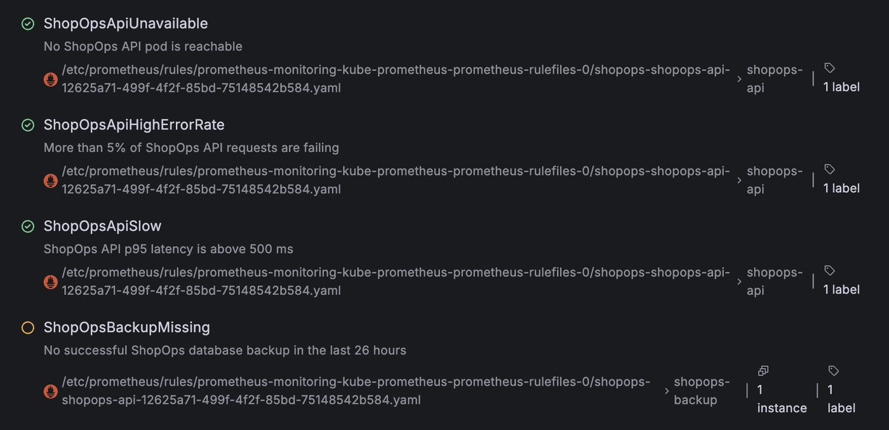

# Postmortem: the 25 November backup did not start

| | |
|---|---|
| **Date** | 25–26 November 2026 |
| **Status** | Resolved. Action items below. |
| **Severity** | Low: no data lost, local learning cluster |
| **Detected by** | `ShopOpsBackupMissing` alert (Pending), seen in Grafana by chance |
| **Root cause** | On a laptop, the cluster's scheduler only counts time while the laptop is awake |

This postmortem is blameless: it is about how the system behaved, not about who did what.

## Summary

The daily database backup is scheduled for 08:00 UTC. On 25 November it did not start. At about 10:00 UTC, 26 hours after the last good backup, the `ShopOpsBackupMissing` alert went to Pending, and it was noticed by chance a few minutes later.

The backup job had never been created. The Kubernetes CronJob controller was healthy, but it was still waiting for its own timer. The cluster runs on a laptop that had been asleep for almost the whole previous day, and the timer only counts time while the laptop is awake. A small change to the CronJob made the controller check it again, and the backup ran at 10:11 UTC.

The next day a cold start showed a second weakness: the backup started before cluster DNS was up. It succeeded only on its last allowed attempt.

## Impact

- No data was lost, and no restore was needed.
- There were 26 h 11 min between two good backups; the target is 24 h. Without the fix, the gap would have kept growing (see [Root cause](#root-cause)).
- On 26 November the backup needed all three of its allowed attempts. One more failure and that day would have had no backup until the next scheduled run.

## Timeline

Times are UTC; Pakistan time is UTC+5.

| Time (UTC) | Event |
|---|---|
| 24 Nov 08:00:03 | The scheduled job `db-backup-29925120` succeeds in 3 s. This is the last good backup before the incident. |
| 24 Nov 08:18 → 25 Nov 09:13 | The laptop is asleep, apart from about one minute. |
| 25 Nov 08:00 | Scheduled time. No job is created. |
| 25 Nov ~10:00 | `ShopOpsBackupMissing` goes Pending, 26 h after the last success. |
| 25 Nov 10:04 | Noticed while taking a Grafana screenshot. Alertmanager is not enabled, so a firing alert would not have notified anyone. |
| 25 Nov 10:07 | The CronJob status shows that both the last scheduled run and the last success were on 24 Nov at 08:00. Only old jobs exist: the job was never created, so it did not fail. |
| 25 Nov 10:11 | An annotation is added to the CronJob. Within 15 s the controller creates `db-backup-29926560` for the missed 25 Nov 08:00 slot; it succeeds in 4 s. |
| 25 Nov 10:13 | The alert is back to Normal. |
| 26 Nov 09:39 | The cluster is down: Docker Desktop is not running. The laptop had most likely restarted for an update, and Docker Desktop did not start on its own. |
| 26 Nov 09:42 | Docker is started. Within a minute the controller creates `db-backup-29928000` for the missed 26 Nov slot. |
| 26 Nov 09:42–09:44 | Two attempts fail with `could not translate host name "db"`. The third and last allowed attempt succeeds at 09:44:03. |



*25 Nov, 10:04 UTC: the backup alert Pending (yellow), the other three rules Normal.*

## Investigation

### Did the backup fail?

No: it never started.

```console
$ kubectl -n shopops get cronjob db-backup -o jsonpath='{.status.lastScheduleTime}  {.status.lastSuccessfulTime}'
2026-11-24T08:00:00Z  2026-11-24T08:00:03Z
$ kubectl -n shopops get jobs
NAME                 STATUS     COMPLETIONS   DURATION   AGE
backup-now           Complete   1/1           7s         26h
db-backup-29925120   Complete   1/1           3s         26h
restore-test         Complete   1/1           4s         26h
```

Nothing had been scheduled since 24 November. There was no job for 25 November, not even a failed one, so there was no error or log line to find.

### Was the controller stuck?

The CronJob has no `startingDeadlineSeconds`, so a missed run is never skipped. The next time the controller checks the CronJob, it starts the run it missed. Any change to the CronJob makes it check again:

```console
$ kubectl -n shopops annotate cronjob db-backup poked-at="$(date -u +%FT%TZ)" --overwrite
$ sleep 15; kubectl -n shopops get jobs
NAME                 STATUS     COMPLETIONS   DURATION   AGE
db-backup-29926560   Complete   1/1           4s         15s
```

The number in the job name is the scheduled time in minutes since 1970, and 29926560 is 25 Nov 08:00 UTC. So the controller worked as soon as it was asked to look; it simply had not looked yet.

### Why had it not looked?

After each run, the controller sets a timer for the next one, 24 hours later. On this laptop the cluster runs inside Docker Desktop's virtual machine, which is frozen while the Mac sleeps. So the timer only moves while the laptop is awake. The alert compares wall-clock times, which stayed correct, so it still saw the full 26 hours.

The macOS power log shows how little the laptop was awake (times in Pakistan time, UTC+5):

```console
$ pmset -g log | grep -E " (Sleep|Wake)  " | awk '$4!=p {print $1, $2, $4; p=$4}'
2026-11-24 12:00:36 Wake      # awake when the 13:00 (08:00 UTC) backup ran
2026-11-24 13:18:55 Sleep
2026-11-24 13:47:37 Wake
2026-11-24 13:47:39 Sleep
2026-11-24 13:47:45 Wake
2026-11-24 13:48:35 Sleep
2026-11-24 15:42:00 Wake
2026-11-24 15:42:01 Sleep
2026-11-25 14:13:47 Wake
2026-11-25 14:53:42 Sleep
2026-11-25 14:57:11 Wake
```

From the last good backup to the fix, 26 h 11 min passed. The laptop slept for 24 h 57 min of that, so the cluster saw only 1 h 14 min go by, and its 24-hour timer still had about 22 h 46 min to run. Without the nudge, the backup would have waited until the laptop had been awake for about another 23 hours, which at this laptop's usage means days.

## Root cause

On a laptop, the cluster's scheduler only counts time while the laptop is awake. Every observation fits this:

- Between the last backup and the fix, the cluster was awake for only 1 h 14 min.
- Nothing was skipped. The missed run started at once when the CronJob changed (25 Nov) and when the cluster restarted (26 Nov).
- Wall-clock times (job timestamps, the alert) were correct throughout.

A cloud server never sleeps, so this only affects the local setup. But it is exactly the kind of silent delay that backups need monitoring for.

### A second finding on 26 November

After the laptop restarted, the cluster came back and the controller started the missed run within a minute, just as the annotation had done. But the backup pod started before the cluster's DNS server was up:

```console
$ kubectl -n shopops logs -l job-name=db-backup-29928000 --prefix
[pod/db-backup-29928000-h4wkf/pg-dump] pg_dump: error: could not translate host name "db" to address: Try again
[pod/db-backup-29928000-fxsbk/pg-dump] pg_dump: error: could not translate host name "db" to address: Try again
[pod/db-backup-29928000-mtdxt/pg-dump] Backup written: /backups/shopops-20261126-094403.dump (4.0K)
```

The first guess was that the database was still starting, but the logs showed it was DNS. The job allows three attempts (`backoffLimit: 2`), and they were used up within seconds of each other. The third attempt worked; if startup had been slower, that day's backup would have failed.

## What went well

- The alert checks the outcome that matters ("a backup succeeded recently"), so it caught a failure that produced no error anywhere.
- Two commands were enough to diagnose it: the CronJob status and the job list.
- Missed runs are never skipped (no `startingDeadlineSeconds`), so one nudge was enough to recover.

## What went wrong

- Detection was luck. Alertmanager is off, so a firing alert reaches nobody.
- The backup did not wait for what it depends on (DNS and the database).
- A 26-hour threshold is right for "no backup in a day", but it is a slow signal for "the backup did not start".

## Action items

| # | Action | Status |
|---|---|---|
| 1 | Before dumping, the backup waits up to 3 minutes for the database, which also covers DNS. A run is stopped after 15 minutes, so a stuck dump cannot block later runs (`concurrencyPolicy: Forbid`). | ✅ Chart 0.5.1 |
| 2 | Send alerts to a phone: Alertmanager with a free Telegram receiver, with the bot token stored as a SealedSecret. | ⏳ Phase 8 |
| 3 | Add a runbook entry for `ShopOpsBackupMissing`: how to tell "late" from "failed", and how to start the missed run. | ⏳ Phase 8 |
| 4 | Earlier signal: alert when the backup is more than an hour past its scheduled time (`kube_cronjob_next_schedule_time`). | ⏳ Phase 8 |
| 5 | Turn on "Start Docker Desktop when you sign in", so a laptop restart does not leave the cluster down. | ⏳ Laptop setting |

## Lessons

- A job that never starts leaves no error to find. Alert on the outcome you need, not only on failures.
- Check the logs before writing down a cause. Here the first guess was wrong.
- On a laptop cluster, the clock the cluster runs on stops while the laptop sleeps. Schedules, timers and leases all stretch. That is most likely also why cert-manager had restarted 30 times in two days: it restarts itself whenever its leader lease runs out.
